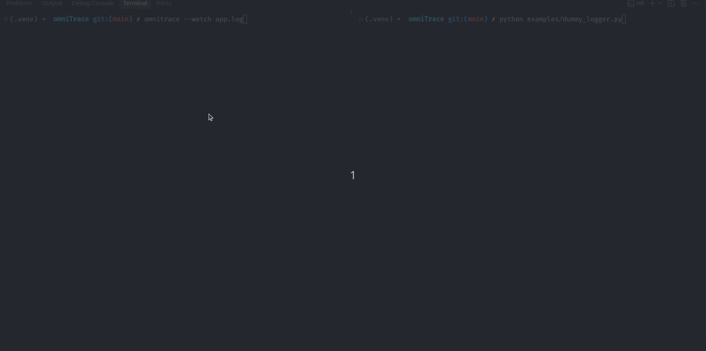

<div align="center">

# ⚡ OmniTrace

### Your local AI debugging daemon. From runtime crash to code patch.

**Stop copy-pasting stack traces. Start fixing bugs where they happen.**

OmniTrace is a local-first, privacy-focused Python debugging daemon that detects runtime failures, uses a locally running LLM to diagnose the root cause, and generates patches for your source code—with your approval.

No cloud AI APIs. No leaking proprietary code. No switching context between your terminal and a chatbot.

<br>


<br>

**[Features](#-features) · [Quick Start](#-quick-start) · [Architecture](#-architecture) · [Safety](#-safety-first) · [Roadmap](#-roadmap)**

</div>

---

## 🎬 See OmniTrace in Action



*From detecting a crash to generating a patch, reviewing the change, and recovering from a bad fix—all within your local development workflow.*

---

## 💡 Why I Built This

Every developer knows the routine.

Your Python application crashes. You copy the traceback, open a browser, paste the error into an AI chatbot, provide additional context, copy the suggested fix, switch back to your editor, and hope the solution doesn't break something else.

It works. But the workflow is fragmented, repetitive, and potentially dangerous when the code belongs to a proprietary codebase.

**I built OmniTrace to bring AI-assisted debugging directly into the runtime workflow.**

Instead of waiting for you to ask for help, OmniTrace watches for failures, captures diagnostic information, and routes the error to a locally running language model. It then generates a targeted patch that you can review and approve.

The goal is simple: reduce the distance between *something broke* and *I have a fix to review*.

### Three principles drive the project

**🔒 Privacy by default**

Your source code and stack traces stay on your machine when using a local Ollama instance. There is no requirement to send debugging context to a hosted AI API.

**⚡ Faster debugging loops**

Catch failures where they occur. Skip the manual copy-paste cycle and get actionable diagnoses directly in your terminal.

**🛠️ From explanation to action**

OmniTrace goes beyond generating suggestions. Its patching workflow can write an AI-generated change directly to a source file after you approve it, with a backup available for rollback.

> **The key idea:** AI should participate in the development workflow, not just answer questions about it.

---

## ✨ Features

### 🔍 1. Background Crash Detection

Run OmniTrace in watch mode and let it monitor your application's logs.

```bash
omnitrace --watch app.log
```

When a supported Python traceback appears, OmniTrace initiates the diagnostic workflow.

- Monitors a log file for runtime failures.
- Extracts relevant error information.
- Routes the diagnostic context to your local AI model.
- Records debugging history for later inspection.

No need to manually submit every exception to an assistant.

### 🤖 2. Local AI Diagnostics

OmniTrace uses [Ollama](https://ollama.com/) to run a local language model.

The AI router sends relevant debugging context to the configured local model, which analyzes the failure and generates a diagnosis and proposed fix.

The result is a workflow that can operate without a third-party AI API.

**The distinction matters:** OmniTrace is not simply an HTTP client wrapped around a hosted LLM. Its diagnostic workflow is designed around local inference, runtime monitoring, persistent debugging history, and source-code patching.

### 🩹 3. Interactive Auto-Patcher

A diagnosis is useful. A reviewable patch is better.

OmniTrace can generate a regex-based source-code patch and ask for your approval before applying it.

The intended workflow is:

1. A runtime failure is detected.
2. The local LLM analyzes the traceback.
3. OmniTrace generates a proposed source-code modification.
4. You review the proposed change and choose whether to apply it.
5. OmniTrace creates a backup before modifying the source file.
6. The patch is applied if approved.

The approval prompt keeps the developer in control.

```text
[OmniTrace] Runtime exception detected.

[AI Router] Analyzing traceback with local LLM...
[AI Router] Diagnosis complete.

[Auto-Patcher] Proposed source-code modification:
             <generated patch>

Apply this patch? [y/n]:
```

*Illustrative terminal output; the exact output depends on your implementation.*

**Important:** Regex-based patches are intentionally lightweight, but they are not syntax-aware. A generated patch can match unintended text or produce invalid Python. Review every change and test the affected code before relying on it.

### ⏪ 4. Safety Net and Rollback

AI-generated code is not guaranteed to be correct.

Before modifying a source file, OmniTrace creates a `.bak` backup so you have a recovery path if the patch introduces a regression.

Restore a file using:

```bash
omnitrace revert path/to/file.py
```

This provides a straightforward recovery mechanism without requiring you to reconstruct the previous file manually.

**Keep your Git working tree clean and commit important changes before applying automated patches.** A backup is a recovery aid, not a replacement for version control.

### 📊 5. Local Debug Dashboard

Inspect your debugging history through a lightweight Flask web interface.

```bash
omnitrace --ui
```

The dashboard uses Flask, HTMX, and Tailwind CSS to present historical crashes and their associated diagnoses.

- Browse previously recorded errors.
- Inspect historical diagnostic information.
- Use the persistent debug ledger to investigate recurring failures.
- Access the dashboard through your local browser.

The dashboard complements the terminal workflow without requiring a separate cloud service.

### 🗃️ 6. Persistent Debug Ledger

OmniTrace uses SQLite to maintain a local history of debugging activity.

Instead of treating every exception as an isolated event, it preserves records that can help you investigate earlier failures and understand recurring problems.

SQLite keeps the persistence layer lightweight, embedded, and easy to run alongside a local development environment.

---

## 🚀 Quick Start

Get OmniTrace running in your local development environment.

### Prerequisites

You'll need:

| Requirement | Purpose |
|---|---|
| Python 3.9+ | Run OmniTrace |
| Git | Clone the repository |
| [Ollama](https://ollama.com/) | Run the local language model |
| Llama 3 | Power local AI diagnostics |

> **Note:** Python 3.9+ is a placeholder requirement. Verify the minimum version supported by your package before publishing.

### Step 1: Install Ollama

Download Ollama from:

https://ollama.com/

Install it and ensure its local service is running.

Pull the model used by your OmniTrace configuration:

```bash
ollama pull llama3
```

Check that the model is available:

```bash
ollama list
```

If your implementation uses a different Ollama model identifier, use that exact identifier instead.

### Step 2: Clone OmniTrace

```bash
git clone https://github.com/YOUR_USERNAME/omnitrace.git
cd omnitrace
```

Replace `YOUR_USERNAME` with the actual GitHub repository owner.

### Step 3: Create a Virtual Environment

**Linux / macOS**

```bash
python3 -m venv .venv
source .venv/bin/activate
```

**Windows (PowerShell)**

```powershell
python -m venv .venv
.venv\Scripts\Activate.ps1
```

### Step 4: Install the Project

Install OmniTrace and its dependencies:

```bash
pip install -e .
```

Verify the CLI installation:

```bash
omnitrace --help
```

If the command is unavailable, check that the project defines the appropriate console-script entry point in its packaging configuration.

### Step 5: Run OmniTrace

Choose the workflow that fits your needs.

**Option A: Monitor application logs**

```bash
omnitrace --watch app.log
```

Start your Python application and let OmniTrace monitor the log file for supported runtime errors.

Make sure your application writes its tracebacks to `app.log`.

**Option B: Launch the dashboard**

```bash
omnitrace --ui
```

Open the local URL printed by the application to inspect the debugging history.

**Option C: Revert a patched file**

```bash
omnitrace revert path/to/file.py
```

Use this command to restore a file from the backup created by OmniTrace, according to your implementation's rollback behavior.

---

## 🏗️ Architecture

OmniTrace combines runtime monitoring, local AI inference, source-code patching, and persistent state into one debugging workflow.

### System Overview

```text
┌─────────────────────────────────────────────────────────┐
│                    Python Application                  │
└───────────────────────────┬─────────────────────────────┘
                            │
                            ▼
┌─────────────────────────────────────────────────────────┐
│                  OmniTrace Daemon                       │
│                                                         │
│  Watches logs → Detects tracebacks → Extracts context   │
└───────────────────────────┬─────────────────────────────┘
                            │
                            ▼
┌─────────────────────────────────────────────────────────┐
│                     AI Router                           │
│                                                         │
│  Builds diagnostic context → Calls local Ollama model  │
└───────────────────────────┬─────────────────────────────┘
                            │
                            ▼
┌─────────────────────────────────────────────────────────┐
│                  Local LLM (Llama 3)                    │
│                                                         │
│  Analyzes the failure → Produces diagnosis and patch    │
└───────────────────────────┬─────────────────────────────┘
                            │
                            ▼
┌─────────────────────────────────────────────────────────┐
│                   Auto-Patcher                          │
│                                                         │
│  Creates backup → Requests approval → Applies patch     │
└───────────────────────────┬─────────────────────────────┘
                            │
                  ┌─────────┴──────────┐
                  ▼                    ▼
┌────────────────────────┐  ┌────────────────────────────┐
│     Source File        │  │      SQLite Ledger         │
│                        │  │                            │
│  Approved code change  │  │  Crash and diagnosis data  │
└────────────────────────┘  └──────────────┬─────────────┘
                                           │
                                           ▼
                              ┌──────────────────────────┐
                              │    Flask + HTMX UI       │
                              │                          │
                              │  Historical debug view   │
                              └──────────────────────────┘
```

*Conceptual architecture; component boundaries and data flow should be aligned with the implementation.*

### Component Breakdown

| Component | Technology | Responsibility |
|---|---|---|
| Daemon | Python | Monitors application logs and detects supported failures |
| AI Router | Python + Ollama | Sends diagnostic context to the local LLM |
| Local Model | Llama 3 via Ollama | Generates diagnoses and proposed code changes |
| Auto-Patcher | Python + Regex | Applies approved source-code modifications |
| Safety Net | File backups | Preserves a recoverable copy before patching |
| Debug Ledger | SQLite | Stores historical debugging records |
| Web Dashboard | Flask + HTMX + Tailwind CSS | Presents historical crashes and diagnoses |
| CLI | Python + Rich | Provides terminal interaction and formatted output |

### How the Components Work Together

**1. Detection**

The daemon watches the configured log file and identifies supported Python tracebacks.

**2. Context extraction**

OmniTrace extracts the relevant error information and prepares it for diagnosis.

**3. AI routing**

The AI router sends the diagnostic context to Ollama, which runs the selected model locally.

**4. Diagnosis and patch generation**

The model returns an explanation and a proposed source-code modification.

**5. Human approval and patching**

The Auto-Patcher requests approval, creates a backup, and applies the accepted change.

**6. Persistence and inspection**

SQLite stores debugging records, while the Flask dashboard provides a visual interface for reviewing historical failures.

The result is a connected workflow from runtime failure to a proposed source-code change, with persistent state and an explicit approval step.

---

## 🔐 Safety First

OmniTrace can modify source files. That makes safety part of the core design, not an optional extra.

### Local inference is not the same as guaranteed privacy

When configured to use a local Ollama instance, the AI inference step does not require sending source code to a hosted AI API.

However, privacy also depends on your application configuration, logs, network settings, and other integrations.

Avoid recording credentials, API keys, access tokens, and other sensitive values in logs.

### AI-generated patches require review

LLMs can produce incorrect or fabricated fixes. Regex-based source transformations introduce additional risks because they do not understand Python's syntax tree or program semantics.

Before applying a patch:

- Review the proposed modification.
- Confirm that the intended source file and text are being changed.
- Keep a version-control checkpoint.
- Run relevant tests after applying the change.
- Revert the change if it causes unexpected behavior.

### Backups are a recovery mechanism, not a transaction system

A `.bak` file is useful for recovering the previous source contents, but it does not guarantee that an operation is atomic, that concurrent edits are preserved, or that every kind of failure can be rolled back safely.

For critical codebases, use Git and a proper test suite alongside OmniTrace.

---

## 🧰 Tech Stack

OmniTrace uses a deliberately lightweight stack designed around local execution.

| Layer | Technology | Why it fits |
|---|---|---|
| Core runtime | Python | Integrates naturally with Python debugging workflows |
| CLI | Rich | Improves terminal readability and interaction |
| Patch engine | Regex | Provides lightweight text-based source transformations |
| AI inference | Ollama + Llama 3 | Runs language-model inference locally |
| Persistence | SQLite | Provides an embedded database without a separate database server |
| Web backend | Flask | Keeps the dashboard backend lightweight |
| Dynamic UI | HTMX | Enables interactive web updates without a large frontend framework |
| Styling | Tailwind CSS | Provides utility-based UI styling |

The architecture keeps the main workflow close to the developer's machine, reducing the need for external services and infrastructure.

---

## 🗺️ Roadmap

OmniTrace v1.0 establishes the core workflow: detect failures, request a local AI diagnosis, propose a patch, and preserve debugging history.

The next step is making that workflow more context-aware and operationally robust.

### Planned Features

- [ ] **Cross-file debugging with RAG**  
  Retrieve relevant code and debugging context across multiple files to improve diagnoses for failures that cannot be understood from a single traceback.

- [ ] **Discord webhook notifications**  
  Send crash summaries and diagnostic alerts to configured Discord channels.

- [ ] **Webhook rate limiting**  
  Prevent repeated crashes from flooding notification channels with duplicate or excessive alerts.

- [ ] **Improved patch validation**  
  Validate proposed modifications and integrate optional syntax checks and targeted test execution.

- [ ] **Smarter patch generation**  
  Explore syntax-aware patching to reduce the risks associated with regex-based source transformations.

- [ ] **Enhanced debug ledger**  
  Improve filtering and searching for recurring exceptions and historical diagnoses.

- [ ] **Configurable model selection**  
  Make it easier to select and configure supported local Ollama models.

- [ ] **Expanded diagnostic context**  
  Incorporate additional relevant runtime information while minimizing unnecessary exposure of sensitive data.

---

## 🤝 Contributing

OmniTrace is an open-source project, and contributions are welcome.

Whether you're interested in debugging workflows, local AI inference, patch validation, or developer tooling, there's room to help improve the project.

### Ways to Contribute

- Report bugs and unexpected behavior.
- Propose new features.
- Improve documentation.
- Add tests for crash detection and patch generation.
- Improve the safety of source-code modifications.
- Help expand local model support.

### Development Workflow

1. Fork the repository.
2. Create a feature branch.
3. Implement and test your changes.
4. Submit a pull request describing the problem and your solution.

For changes to the patching engine, include tests covering both intended replacements and cases where the target source text should remain unchanged.

---

## 📄 License

OmniTrace is intended to be released under the MIT License.

See [`LICENSE`](LICENSE) for the full license text.

*Add the actual MIT license file to the repository before publishing this claim.*

---

<div align="center">

### ⚡ Debug locally. Patch deliberately. Keep your code private.

**OmniTrace — Turning runtime failures into actionable fixes.**

If you find OmniTrace useful, consider giving the repository a ⭐ on GitHub.

</div>